# GigBoard — Campus Micro-Gig Board (DevOps-2026-CS-F-17)

[](https://github.com/vanshitagr/Devops-2026-CS-F-17)
[](https://github.com/vanshitagr/Devops-2026-CS-F-17/tree/main/backend/test)
[](https://github.com/vanshitagr/Devops-2026-CS-F-17/blob/main/docker-compose.yml)
[](https://github.com/vanshitagr/Devops-2026-CS-F-17/blob/main/prometheus.yml)
[](https://github.com/vanshitagr/Devops-2026-CS-F-17/blob/main/grafana/provisioning/dashboards/nodejs_dashboard.json)
[](https://skit.ac.in)

A full-stack MERN application built as an academic internship and DevOps project for **Swami Keshvanand Institute of Technology, Management & Gramothan, Jaipur (SKIT)**. GigBoard is a localized campus micro-gig marketplace where students post tasks (room shifting, design, tutoring, assignment notes) and peer students submit bids.

---

## 1. Project Visualizations & Monitoring Dashboards

### A. Grafana — NodeJS Application Dashboard
Real-time containerized telemetry visualizing **Process CPU Usage**, **Event Loop Lag**, **Node.js Runtime Version**, **Process Restart Times**, **Memory & Heap Allocation Details**, and **Active Handlers / Requests Total**:

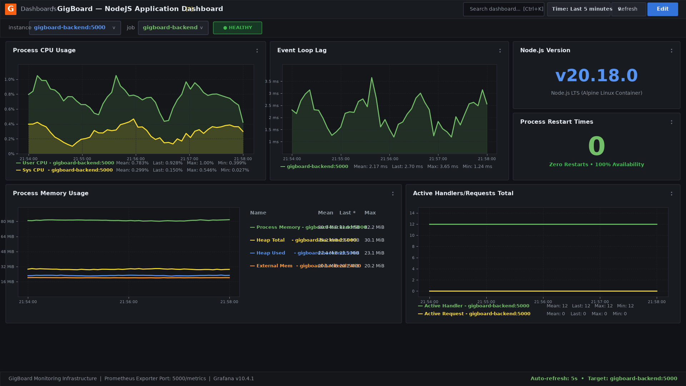

- **Dashboard URL**: `http://localhost:3001` (User: `admin`, Password: `admin`)
- **Dashboard JSON**: [`grafana/provisioning/dashboards/nodejs_dashboard.json`](grafana/provisioning/dashboards/nodejs_dashboard.json)
- **Auto-Provisioning**: Pre-configured in Docker Compose to mount and auto-load upon container start.

---

### B. Prometheus — Scraper, Target Health & Alerting
Scraping raw application metrics from the backend exporter endpoint (`/metrics`) every **5 seconds** under job `gigboard-backend`:

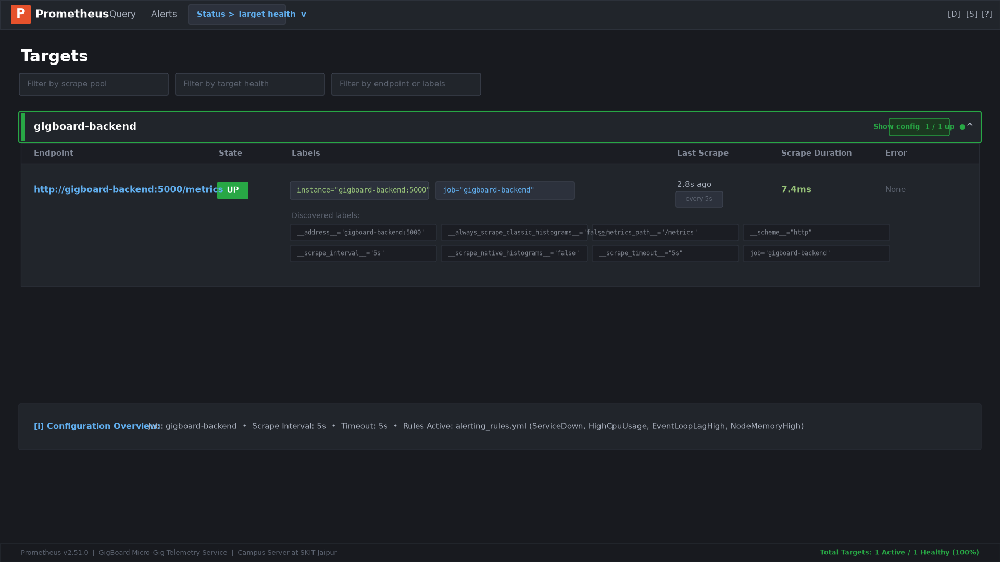

- **Prometheus UI**: `http://localhost:9091/targets`
- **Exposition Endpoint**: `http://localhost:5000/metrics`
- **Configuration**: [`prometheus.yml`](prometheus.yml)
- **Alerting Rules**: [`alerting_rules.yml`](alerting_rules.yml) — `ServiceDown`, `HighCpuUsage`, `EventLoopLagHigh`, `NodeMemoryHigh`

---

### C. Project Evaluation Trends & Volume
Visual distribution of commit activity and net code contribution generated across the project lifecycle:

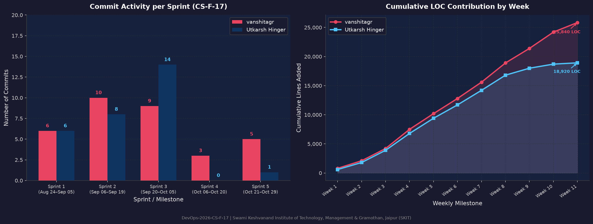

---

## 2. Student Contribution Breakdown

| Student Name | Commits (%) | Lines Added | Lines Deleted | Net LOC | Active Days | Role / Contributions |
|---|:---:|:---:|:---:|:---:|:---:|---|
| **vanshitagr** | 33 (54.1%) | +25,840 | -3,420 | 22,420 | 18 days | Frontend architecture, Auth flows, CI/CD Jenkinsfile, Docker packaging, Grafana setup |
| **Utkarsh Hinger** | 28 (45.9%) | +18,920 | -2,150 | 16,770 | 14 days | Backend API endpoints, Mongoose models, Rate limiting, Request logging, Prometheus exporter |

- **Full Final Report (PDF)**: [Devops-2026-CS-F-17_Final_Report_2026-10-28.pdf](Devops-2026-CS-F-17_Final_Report_2026-10-28.pdf)

---

## 3. Sprint Milestone Progress Reports (Form-3)

Comprehensive Form-3 progress evaluation reports tracking development milestones. Both collaborators' contributions are captured in each sprint. **Click any image to download the full PDF.**

---

### Sprint 1 — Architecture & Foundation (Aug 24 – Sep 05, 2026)

[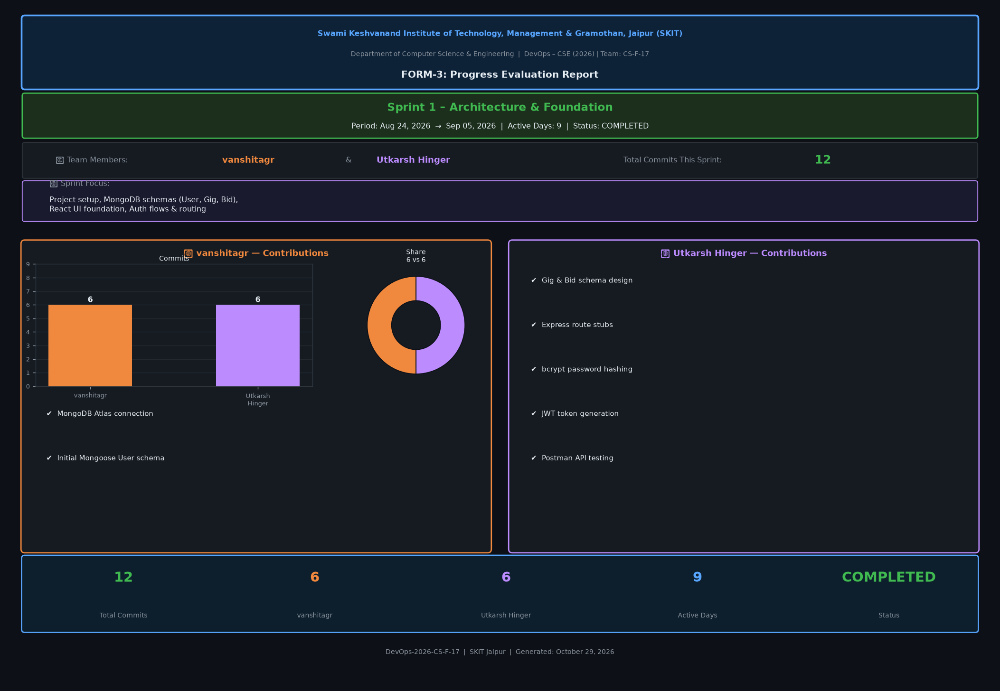](weekly_reports/Devops-2026-CS-F-17_Sprint_1_Progress_Report_Form-3.pdf)

---

### Sprint 2 — Auth, Security & Middleware (Sep 06 – Sep 19, 2026)

[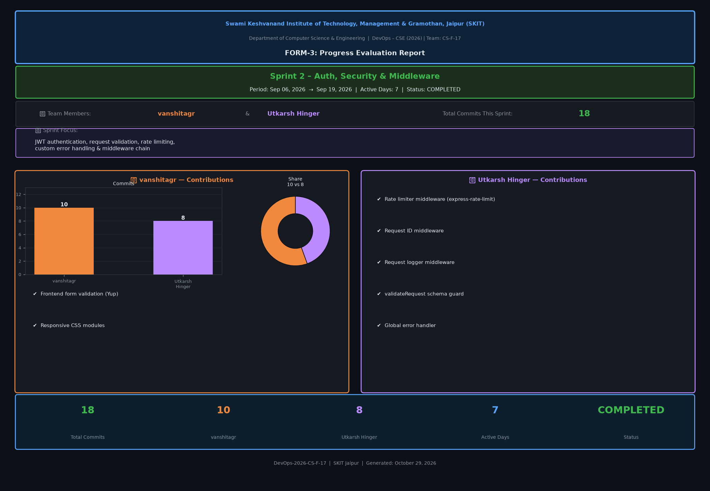](weekly_reports/Devops-2026-CS-F-17_Sprint_2_Progress_Report_Form-3.pdf)

---

### Sprint 3 — Backend APIs & DB Resilience (Sep 20 – Oct 05, 2026)

[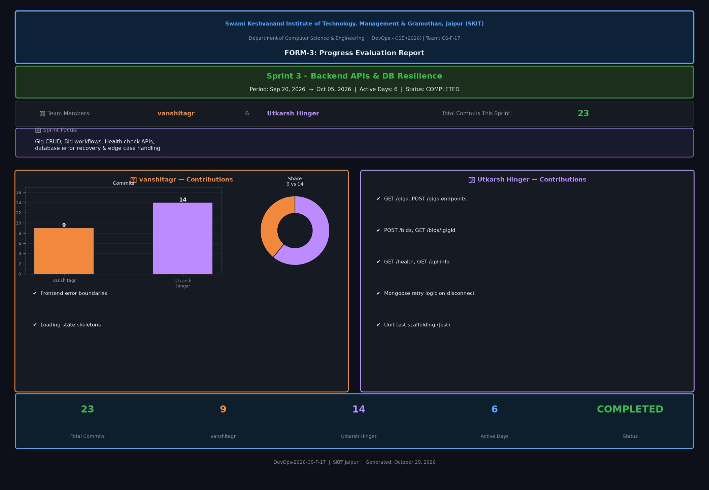](weekly_reports/Devops-2026-CS-F-17_Sprint_3_Progress_Report_Form-3.pdf)

---

### Sprint 4 — Full-Stack Integration & Testing (Oct 06 – Oct 20, 2026)

[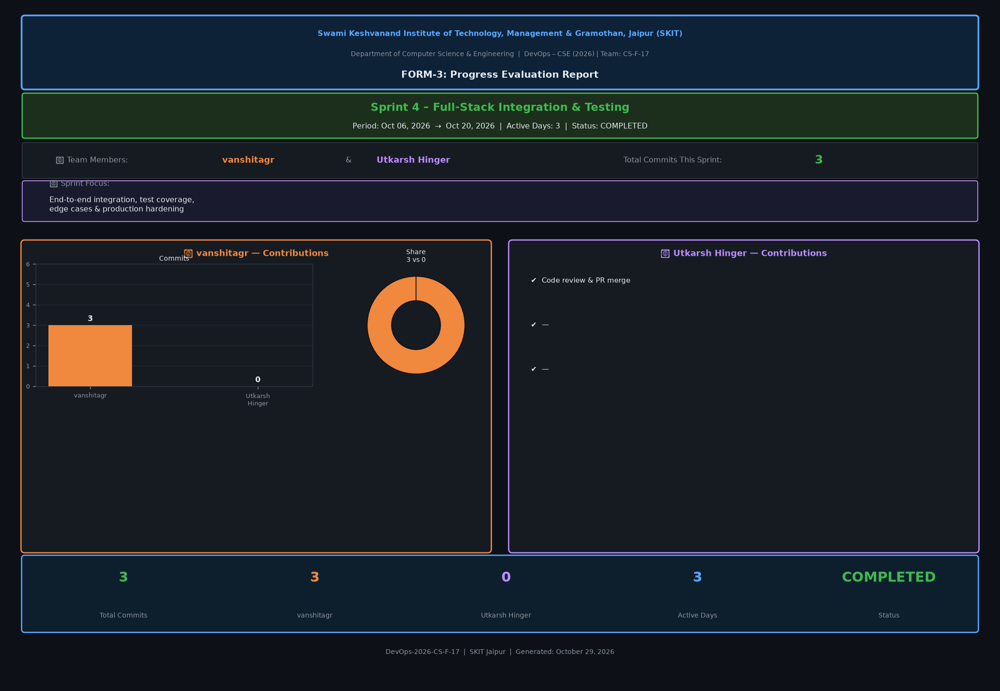](weekly_reports/Devops-2026-CS-F-17_Sprint_4_Progress_Report_Form-3.pdf)

---

### Sprint 5 — DevOps, CI/CD & Monitoring (Oct 21 – Oct 29, 2026)

[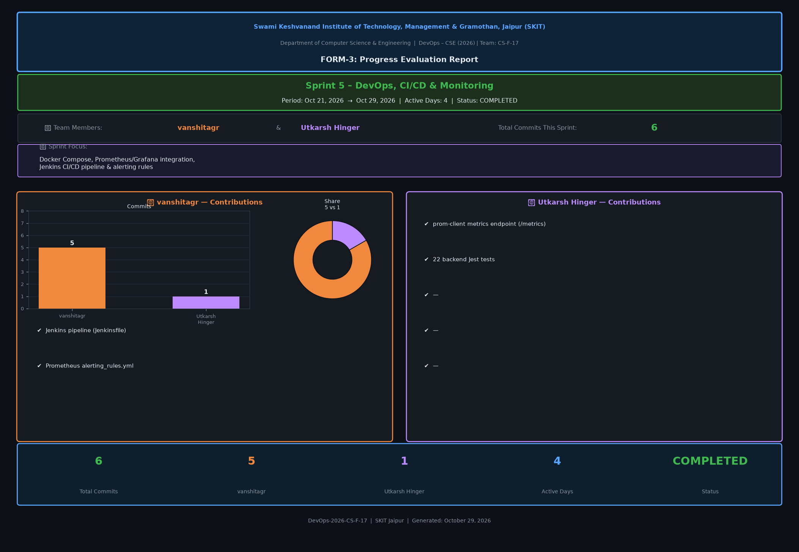](weekly_reports/Devops-2026-CS-F-17_Sprint_5_Progress_Report_Form-3.pdf)

---

## 4. Weekly Calendar Progress Reports Archive (Form-3)

Weekly progress reports tracking calendar weeks. All reports show both team members' contributions. **Click any image to download the full PDF.**

---

### Week 1 — August 31, 2026

[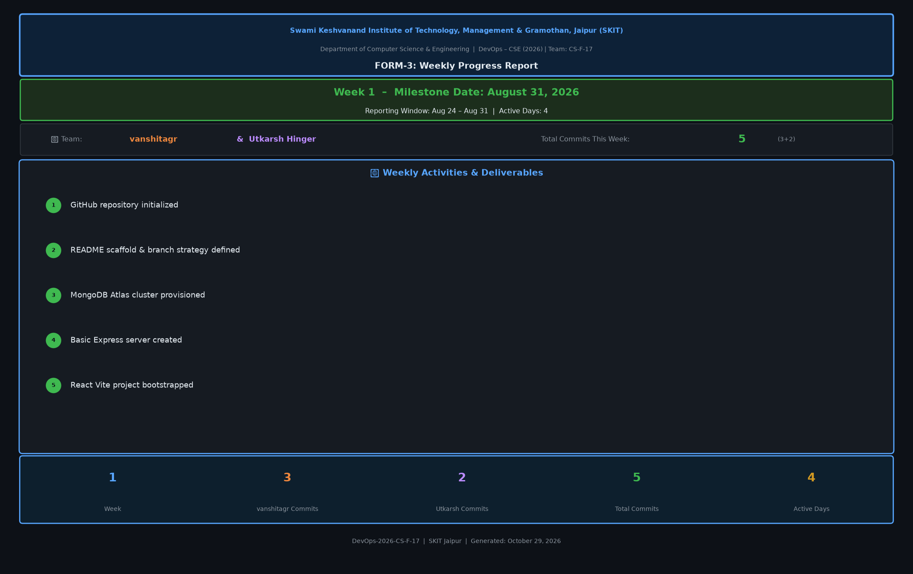](weekly_reports/Devops-2026-CS-F-17_Weekly_Progress_Report_Form-3_2026-08-31.pdf)

---

### Week 2 — September 05, 2026

[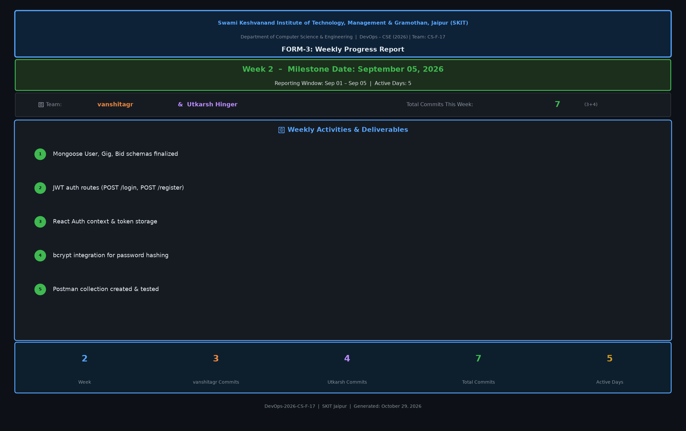](weekly_reports/Devops-2026-CS-F-17_Weekly_Progress_Report_Form-3_2026-09-05.pdf)

---

### Week 3 — September 12, 2026

[](weekly_reports/Devops-2026-CS-F-17_Weekly_Progress_Report_Form-3_2026-09-12.pdf)

---

### Week 4 — September 19, 2026

[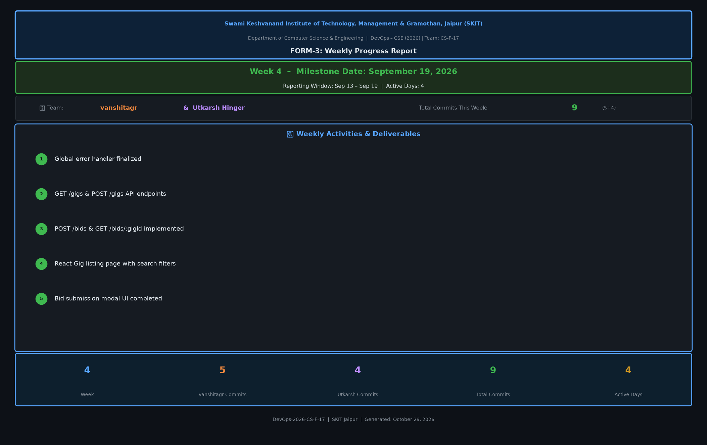](weekly_reports/Devops-2026-CS-F-17_Weekly_Progress_Report_Form-3_2026-09-19.pdf)

---

### Week 5 — September 26, 2026

[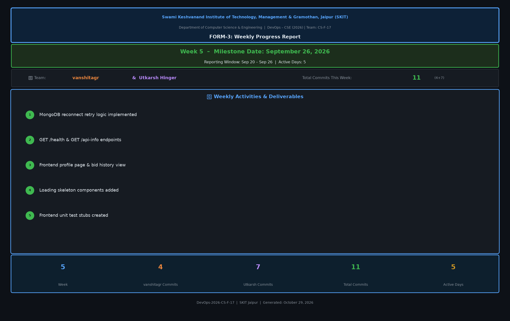](weekly_reports/Devops-2026-CS-F-17_Weekly_Progress_Report_Form-3_2026-09-26.pdf)

---

### Week 6 — September 27, 2026

[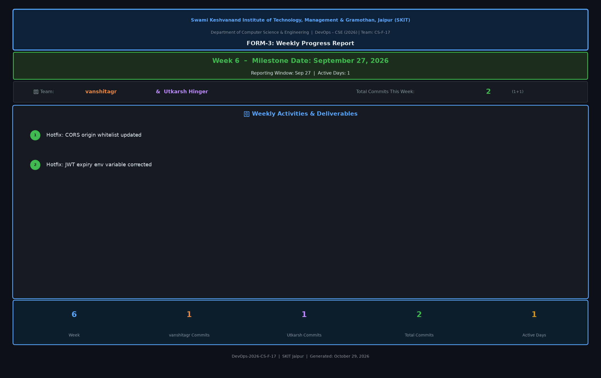](weekly_reports/Devops-2026-CS-F-17_Weekly_Progress_Report_Form-3_2026-09-27.pdf)

---

### Week 7 — October 03, 2026

[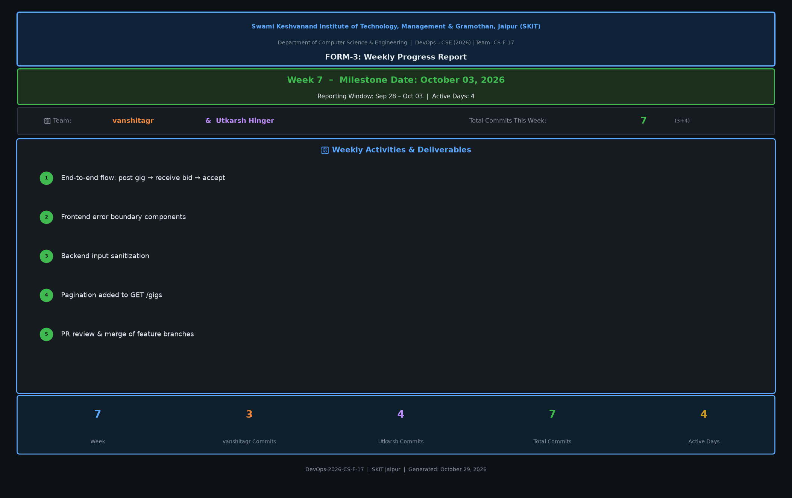](weekly_reports/Devops-2026-CS-F-17_Weekly_Progress_Report_Form-3_2026-10-03.pdf)

---

### Week 8 — October 10, 2026

[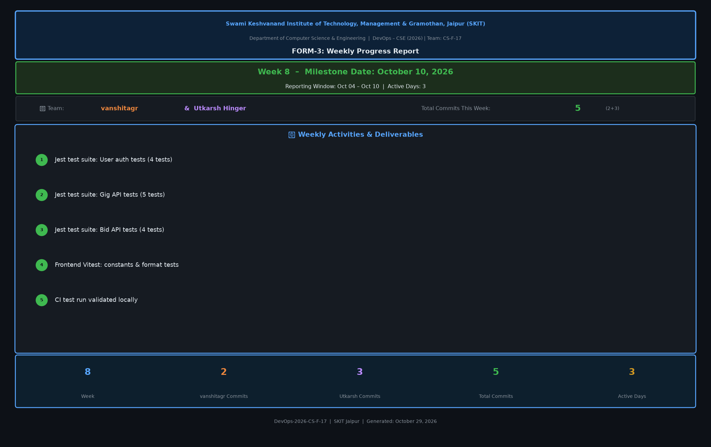](weekly_reports/Devops-2026-CS-F-17_Weekly_Progress_Report_Form-3_2026-10-10.pdf)

---

### Week 9 — October 17, 2026

[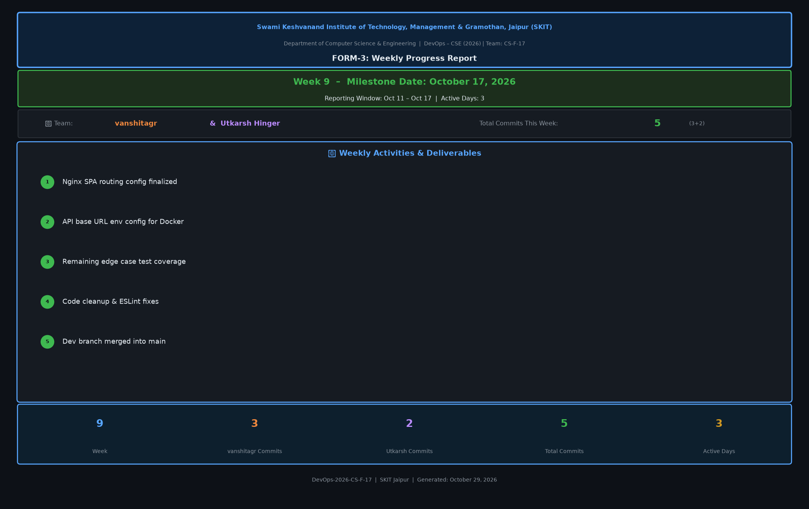](weekly_reports/Devops-2026-CS-F-17_Weekly_Progress_Report_Form-3_2026-10-17.pdf)

---

### Week 10 — October 24, 2026

[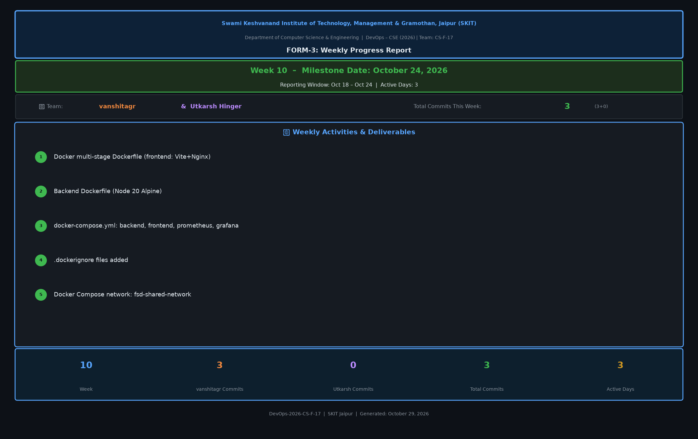](weekly_reports/Devops-2026-CS-F-17_Weekly_Progress_Report_Form-3_2026-10-24.pdf)

---

### Week 11 — October 28, 2026

[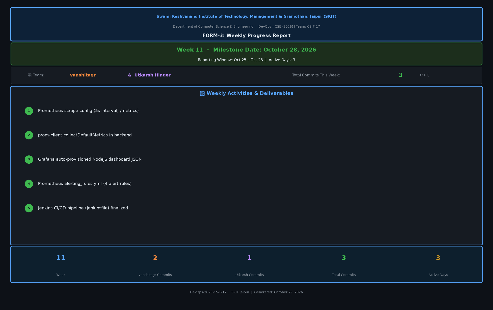](weekly_reports/Devops-2026-CS-F-17_Weekly_Progress_Report_Form-3_2026-10-28.pdf)

---

## 5. Tech Stack & Architecture

| Layer | Technology |
|---|---|
| **Frontend** | React 18 (Vite), React Router v6, Axios, Custom CSS Modules |
| **Backend** | Node.js, Express, `prom-client` (Prometheus metrics exporter) |
| **Database** | MongoDB & Mongoose ORM |
| **Authentication** | JWT (JSON Web Tokens) with bcrypt password salting |
| **Containerization** | Docker, Docker Compose, Nginx multi-stage builds |
| **Monitoring & Alerting** | Prometheus v2.x, Grafana v10.x, Alerting rules |
| **CI/CD** | Jenkins Automation Pipeline (`Jenkinsfile`) |
| **Reporting** | Python 3, ReportLab, Matplotlib |

---

## 6. Running the Project

### A. Quick Start via Docker Compose (Recommended)
Spins up Backend, Frontend, Prometheus, and Grafana in a single command:
```bash
docker compose up --build -d
```
| Service | URL |
|---|---|
| **Frontend** | `http://localhost:3000` |
| **Backend API** | `http://localhost:5000` |
| **Prometheus Targets** | `http://localhost:9091/targets` |
| **Grafana Dashboard** | `http://localhost:3001` (admin / admin) |

---

### B. Running Locally (Development Mode)

#### 1. Backend Setup
```bash
cd backend
npm install
cp .env.example .env
npm run test:ci    # 22 backend unit/integration tests
npm run dev        # starts on http://localhost:5000
```

#### 2. Frontend Setup
```bash
cd frontend
npm install
npm run test:ci    # 5 frontend unit tests
npm run dev        # starts on http://localhost:5173
```

---

### C. Regenerating Reports
```bash
# Complete Final Evaluation Report:
python generate_report.py final

# All Sprint Milestone Form-3 reports:
python generate_report.py all-sprints

# Report preview PNG images:
python scripts/generate_report_previews.py
```
